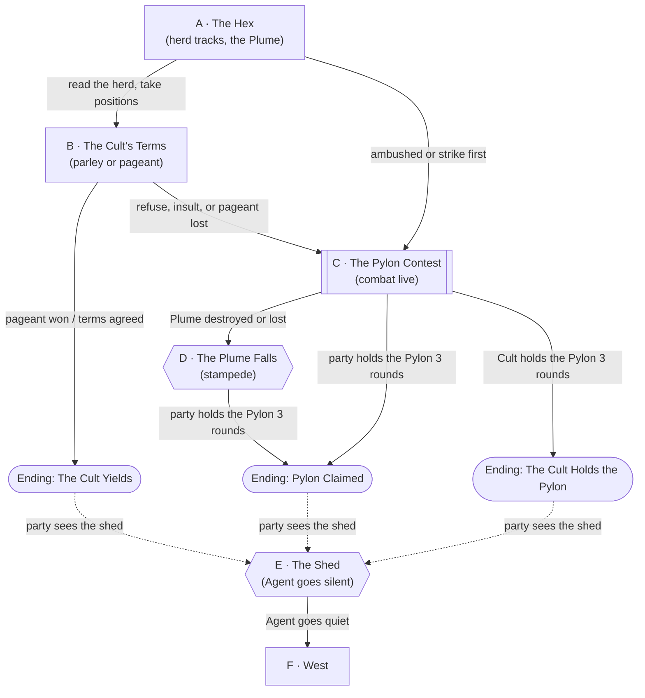

# A Glitch

## Premise

Session 9. The party leaves [Briarwood Mall](../world/places/briarwood-mall.md) for [Meridian Peak](../world/factions/meridian-peak.md)
and picks a hex on the Territory Map (Roll20: **All Pages > Session Starters > Territory Map**). The hex they pick is
holding a [Pylon](../world/lore/pylons.md), and the [Cult of the Swan](../world/factions/cult-of-the-swan.md) is
already there. The cult has found a way to steer a herd of
[Aether Hornbacks](../world/races/aether-hornbacks.md) and is using it to run the party off. Whoever holds the Pylon
survives the phase: **if the Cult holds it, the Cult survives as a group; if the Mall Rats hold it, they survive another
round of the Blood Bowl.**

Once that is settled, the party sees something that doesn't belong on the hex: an old shed in a patch of ground that
doesn't match the rest of the zone. Close to it, [Agent](../world/npcs/agent.md) goes quiet, and nobody watching the
World Merge Event can see the party any more. Something there tells them to go **west**, to an area outside the
Merge Event. West is not closer to Meridian Peak.

## Escalation Trigger(s)

- **Combat goes live at Node A or B,** the moment the party refuses the Cult's terms, strikes first, or fails to read
  the herd before it arrives. Nothing here forces it; the Cult would rather win on beauty than blood.
- **Hard trigger, Node C, round 1:** the Cult starts its claim on the Pylon. A claim that is held for three
  consecutive rounds ends the contest for the Cult.
- **Hard trigger, Node D:** the Plume falls. The herd stampedes.
- **Hard trigger, Node E:** the Pylon is settled and the party reaches the shed. Agent's voice cuts out and the
  broadcast loses them. The scene then belongs to you.

## Party

- **Tier/level:** level 4. A claim levels them to 5.
- **Assumed size:** 4.
- Combat numbers are sized for four level-4 characters. See Combat Notes.

## Node Graph

Run order is A → B → C, with the shed as the aftermath. Every arrow into C is an optional route into combat,
not a requirement.





Legend: rectangle = ordinary node, subroutine box = combat is live, hexagon = a hard DM-scripted beat,
stadium = an ending. Dotted arrows are your call, not a roll.

### Node A — The Hex

**Map:** the Roll20 page **All Pages > Act Two 2 - Cimarron Flats** (the Pylon at the foot of the windmill, the dry
creek on one side, the fence line on the other). The hex itself is new; reuse the map and don't name the place after
the Kin's Flats.

**Situation:** The Territory Map brings the party to the chosen hex. A Pylon hums at the windmill, and a
wide dust-cloud is crossing the plain toward them: a herd, moving in a line, not in a panic. Above the herd
a tall pole glints in the light, wound with feathers, and the party can hear an *awful* honking. On the Pylon's
far side, orcs in a great many feathers are setting up camp as if they own it.

**Approaches:**
- *Read the dust-cloud* — DC 10 (Survival or Nature). Success: these are Aether Hornbacks, a grazing herd, and
  they are being **led**, not stampeding; the line of the herd points at the party, not at the Pylon. A failure
  means the herd arrives in round 1 with the party in the open (Node C, no free movement).
- *Spot what's leading them* — DC 10 (Perception). Success: the tall pole is a **Plume**, a standard of swan,
  goose and duck feathers that the herd keeps its eyes on. This is the control, and the clue to Node D.
- *Notice the herd is wrong* — DC 5 (Animal Handling or Insight). Success: the Hornbacks look *transfixed*,
  and when the Plume tips, they all lean the same way.
- *Reach the Pylon first* — DC 10 (Athletics or Acrobatics) to cross the open ground before the cultists do.
  Success: the party starts the claim at the Pylon (see Node C). Failure: the cultists get there first.
- *Talk first* — go to Node B.

**Complications available here:** a Hornback calf has wandered off from the herd; Deacon is already in the next hex.

### Node B — The Cult's Terms

**Situation:** [Vainhusk](../world/npcs/vainhusk.md), draped in more feathers than any bird could have supplied, steps
out of the camp and calls the party plainly ugly. The Cult needs the Pylon or the Cult is **retired** at the end of the
phase. Vainhusk is utterly sincere about this. He would rather win it by beauty than by killing for it, and will say so.

If he notices [Geezus](../world/people/sesug-tsirch.md), a humanoid goose, he will not take his eyes off the feathers.

**Approaches:**
- *Face-saving terms* — DC 15 (Persuasion). Success: Vainhusk agrees to settle it by **pageant** (below) rather than
  blades. Failure: he takes it as an insult and the Plume tips toward the party (Node C). Give him a way to stand
  down with pride, since he doesn't know how to back down.
- *Pageant of plumage* — the Cult's own contest. Each side picks a champion; Vainhusk judges "most beautiful." DC 15
  (Performance or Persuasion), with advantage for **Geezus** or anyone with real feathers. Win: the Cult yields the
  Pylon (Ending: The Cult Yields). Lose or cheat: Node C.
- *Offer the Cult a place* — DC 10 (Persuasion). The one cultist who survived Session 7 already lives at the mall.
  Success: Vainhusk is willing to talk about the Cult's survival *outside* the Pylon. Decide what the Administration
  does with a retired faction (see Endings).
- *Mock the feathers* — DC 5 (Intimidation or Performance). Success: morale breaks at the Cult's front line (one cultist backs
  off) but Vainhusk charges. Straight to Node C.
- *Strike first* — Node C, and the herd arrives in the same round.

**Complications available here:** a cultist asks Geezus to autograph a feather.

### Node C — The Pylon Contest

**Combat is live.** The Plume tilts and the herd comes.

**Setup:** the Pylon is at the windmill. The Cult has a claimant at the Pylon from round 1 (a cultist). The rule from
[the Blood Bowl](../world/lore/the-blood-bowl.md) applies to both sides: touch the Pylon (DC 10 Arcana or Tinker's
Tools, a handshake with Agent's tech), then **hold it for three consecutive rounds with no enemy within 30 feet.**
Any enemy within 30 feet of the Pylon at the end of a round **resets** that side's count. Both sides can be at 0
indefinitely; the party's job is to keep the Cult at 0 while building their own count.

**Round-by-round:**
- **Round 1:** Vainhusk raises the Plume. 2 Hornbacks and 2 Swan Cultists come in. The Cult sends one cultist to touch
  the Pylon.
- **Round 4:** if the Plume is still standing, a **Hornback Bull** arrives.
- **The herd** follows the Plume while it stands (the Lure, below).

**Approaches:**
- *Kill or knock down the Plume* — AC 12, 20 hp, immune to poison and psychic damage. Triggers Node D. It is held
  by Vainhusk and he defends it.
- *Redirect the herd* — DC 15 (Performance or Persuasion) to give the herd something *more* beautiful to follow.
  Geezus, or any feathered or gleaming creature, can do this at DC 10. Success: the Lure follows the new target
  for 1d4 rounds.
- *Calm the herd* — DC 15 (Animal Handling). The Hornbacks break the Lure for one round.
- *Use the dry creek and fence line* from the Cimarron map: the creek is half cover, barbed wire is difficult terrain.
- *Dislodge the claimant* — move within 30 feet of the cultist at the Pylon to reset their count.
- *Touch and hold the Pylon* — as above.

**The Lure.** While the Plume stands and a Hornback can see it, the Hornback is **Lured**: on its turn it
moves toward and attacks the nearest creature that isn't a cultist. It ignores the Plume itself.

**Complications available here:** the Pylon hums louder when both sides touch it at once; Deacon is on the horizon.

### Node D — The Plume Falls

**Hard trigger: whenever the Plume is destroyed or knocked from Vainhusk's hands.** The Lure ends. The Hornbacks
**stampede** away from where it fell for 2 rounds:
- Every creature in a 10-foot-wide lane from the Plume's spot to the map edge takes 3d6 bludgeoning, DC 13
  Dexterity save for half, and is knocked prone on a failure.
- Hornbacks no longer attack on their own and are **frightened of the nearest loud noise**. After 2 rounds, they
  stop and graze.
- Vainhusk, who hates ugliness, is furious. He fights on, or tries to pick the Plume back up (a bonus action).

### Node E — The Shed

**Hard trigger: the Pylon is settled.** Agent announces the result, and then, past the edge of the hex, the
party sees something out of place: an **old-looking shed**, in ground that doesn't match the rest of the hex.

**What is fixed:**
- As the party gets close, **Agent's voice is silent.** The radio and the Pylon go quiet.
- Whoever is watching the World Merge Event **cannot see the party** here.
- Something inside or around the shed says: **find another area free from the World Merge Event, to the west.**
- West is *not* closer to Meridian Peak.

**What is yours to fill in:** what the shed looks like, what the ground is doing, what speaks, and what it wants.
Prompts below are suggestions, not canon.

- **Terrain contrast.** Dead plain around, but a few steps out: green grass, a different season, an older sky, or
  something that fails to render, like the seam of a map.
- **Time.** Rounds don't tick down, the Pylon doesn't hum, and no one claims anything.
- **Agent's absence.** Agent will notice the party disappeared from the feed and will want to ask where they were.
  Decide how it reacts when they re-emerge.

### Node F — West

Leaving the shed, the party can follow the message west or go on to Meridian Peak. Decide whether the west is
tonight's problem or next session's.

### Endings

- **Pylon Claimed.** The party touches and holds the Pylon for three consecutive rounds. Agent announces it; the
  party levels to 5; **they survive another round of the Blood Bowl.** The Cult is retired, unless the party spares them.
- **The Cult Holds the Pylon.** The Cult touches and holds for three rounds. Per the rule above, **the Cult survives as a
  group** and the party is a territory behind. *Proposal:* the party is not eliminated yet, but must claim another
  Holding before the phase ends. Change it if you prefer.
- **The Cult Yields.** The pageant is won or the terms agreed, and Vainhusk gives up the Pylon. *Proposal:* the party
  holds the Pylon and levels, and the Cult asks for refuge at the mall to avoid retirement. The mall already shelters
  one cultist, and Phil as Mall King could grant it. Agent's treatment of a faction that leaves the game is yours
  to decide.

## Complication Bank

- **Geezus is the most beautiful bird in the world.** The Cult, the herd, and Vainhusk all want his feathers.
- **The herd flinches at honks.** A loud honk stops the nearest Hornback for a round (or sends it in the wrong direction).
- **A calf wanders into the lane** before the stampede, and someone has to decide whether to save it.
- **The Pylon hums for both sides** the moment two claimants touch it in the same round.
- **Deacon wanders in** and begins eating. Everyone stops and stares.
- **The Plume is a genuine mess:** swan, goose, duck, a pigeon. One feather in it is a mall-fountain duck.
- **Agent crackles through a radio** with odds, then cuts out in the middle of a word.

## Combat Notes

Statblocks are in [Aether Hornbacks](../world/races/aether-hornbacks.md), [Vainhusk](../world/npcs/vainhusk.md) and
[Swan Cultist](../world/npcs/swan-cultist.md). Tokens are in the Roll20 journal folder **Session 9 - A Glitch**.

- **Wave 1 (about 750 XP, hard for 4 level-4 PCs):** [Vainhusk](../world/npcs/vainhusk.md) (CR 2, 450 XP),
  2 [Aether Hornbacks](../world/races/aether-hornbacks.md) (CR 1/2, 100 XP each), and 2
  [Swan Cultists](../world/npcs/swan-cultist.md) (CR 1/4, 50 XP each).
- **Wave 2 (round 4, only if the Plume still stands):** the [Hornback Bull](../world/npcs/hornback-bull.md)
  (CR 2, 450 XP). That makes it deadly if the Plume is up for the whole fight. Drop the Bull if the party is
  already hurting.
- **Party disadvantage factors:** the Cult is contesting the Pylon, so the party can't just fight. A party that spent
  rounds on the parley arrives at full strength. A party that failed Node A may start in the open.
- **What ends the fight without a kill:** the Plume falls (the herd leaves), two cultists down (the Cult asks for
  terms), a won pageant, or the Pylon being held for three rounds.
- **Rewards:** the Pylon, a level (to 5), and whatever the party takes from the Plume.

---

[← Back to encounters index](README.md)
