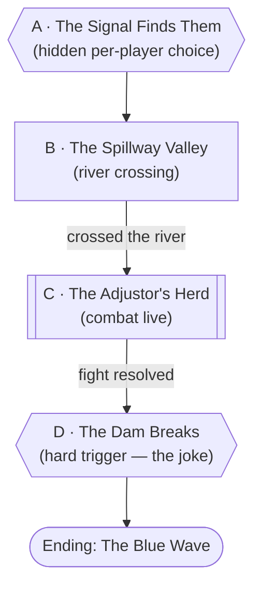
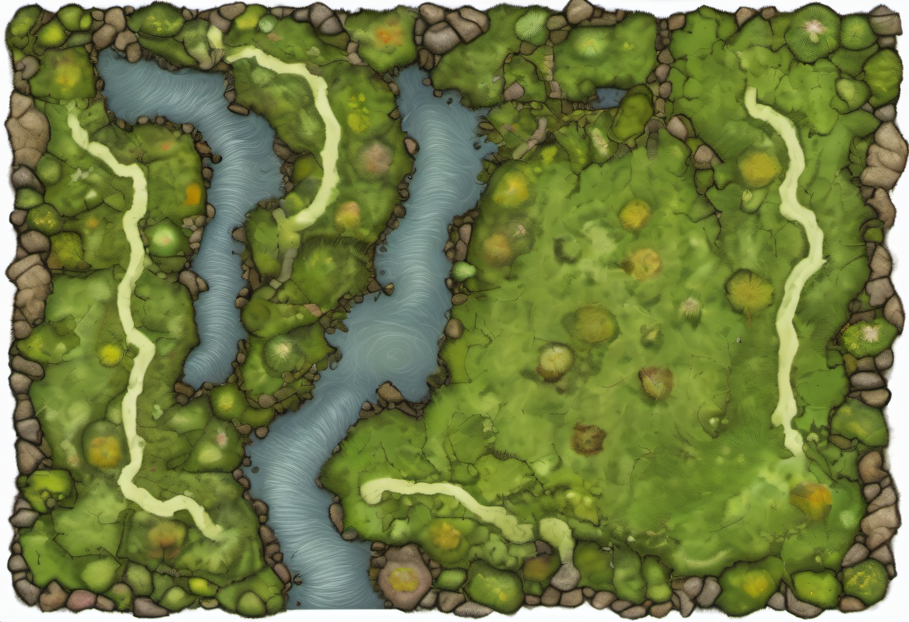

# The Blue Wave

## Premise

Leaving the shed and its dead zone behind, the party heads west, looking for another pocket of
ground Agent's signal can't reach. They don't find one. Instead, right at the edge of the static,
[Agent](../world/npcs/agent.md) finds *them* — for the first time ever catching a gap in its own
footage of its own contestants, and visibly unable to let that go. What it does about that gap is
Node A, and it's personal to each player.

Past that, the session is a straight line on purpose: a grassland valley, a river to cross, a
wandering necromancer with a grudge about a thirty-four-year-old election running a herd of zombie
dinosaurs for Agent's amusement, and then — once the fight's won and everyone's feeling good about
their new level 5 toys — a dam a mile north blows apart and sends a very large, very blue wave
down the valley at the party. Don't fight the structure; it's built to land one joke at the end
and everything before it is runway.

## Escalation Trigger(s)

- **Hard, Node A:** fires the instant the party leaves the static zone. Not rolled.
- **Hard, Node D:** the dam explodes once Node C's fight ends — on a short delay if you want one
  more beat of calm first, but it is not optional and it is not avoidable. This is the payoff;
  don't let a clever plan skip it.
- **Soft, Node C:** combat opens the moment the party is close enough to be noticed, or the moment
  they approach the herd — Roy isn't subtle and doesn't need to be snuck up on to justify a fight.

## Party

- **Tier/level:** level 5, fresh off last session's level-up.
- **Assumed size:** 4.
- Node C is deliberately not hard — see Combat Notes. This is a victory-lap fight: let the new
  level 5 abilities feel great.

## Node Graph





This one is intentionally linear — A → B → C → D, no branches that skip the ending. Approaches
within each node still vary; the sequence of nodes doesn't.

### Node A — The Signal Finds Them

**Situation:** The static thins, then drops away entirely, and mid-step Agent's voice snaps back
in — not its usual smooth cold open, but startled, almost offended: *"...wait. Wait, hold on.
Why don't I have you? You're — you're MY contestants, I'd know you anywhere, so why is there a
GAP—"* Agent is not confused about who they are. It's confused, and audibly upset, about the
fact that its own footage of them has a hole in it. Per [Agent](../world/npcs/agent.md)'s
established character, this is exactly the kind of unfinished-story gap it cannot stand (see that
file's "obsessions" section) — play the upset as real, not performative.

Agent "fixes" the gap the only way it knows how: pushing directly at the edges of each
character's awareness, demanding back in.

**Mechanic — run this privately, one player at a time, out of the others' earshot (a whispered
aside, a passed note, a DM/player text thread, whatever the table uses):**

> *Agent is pushing directly at the edge of your mind, insistent, almost pleading under the
> irritation. It wants back in. Do you let it in, or do you resist?*

- **Resist:** 2d6 psychic damage, and a sudden, genuinely alarming nosebleed.
- **Let it in:** no damage — but Agent gives the character a nosebleed anyway, on its way back in,
  specifically so it doesn't look any different from outside.

Every character ends this beat with a nosebleed, and from the outside, the party can't tell who
actually resisted and who didn't just by looking. That's the point, not an accident — Agent giving
compliant characters a matching nosebleed is it covering its own tracks, not a kindness; it would
rather nobody at the table (in character or out) can prove who let it back in and who didn't.
**Don't resolve this hook any further this session.** Record each player's choice somewhere, off
to the side; it's a live thread for the next Agent-free zone the party finds, not for today.

---

### Node B — The Spillway Valley

**Situation:** Open grassland — Earth-or-Faerun in texture, nothing Aether-oversized grazing in
it this time — running down to a wide river. Upstream, barely visible to the north, a pale line
that resolves into a dam if anyone looks hard enough. See
[The Spillway Valley](../world/places/the-spillway-valley.md).

**Approaches:**
- *Find a safe ford* — DC 10 (Survival or Nature). Success: the party crosses together, no
  complications.
- *Swim or wade it* — DC 15 (Athletics). Success: across. Failure: swept 30 feet downstream,
  separated from the group for a round — inconvenient, not dangerous. No monsters live in this
  river.
- *Rig a line across* — DC 10 (Athletics, or Tinker's Tools for anyone building an actual rig —
  Jack's wheelhouse). Success: the whole party crosses together, no individual rolls needed.
- *Spot the dam* — DC 20 (Perception), available any time this node is active. Success: close
  enough to resolve detail at that range to tell something is actively fighting up there — shapes,
  flashes, nothing identifiable. **This is a genuine Chekov's-gun payoff for Node D** — see that
  node's "What a successful Node B Perception check buys" for the mechanical reward.

**Complications available here:** a startled flock of ordinary birds breaking cover; a derelict
rowboat caught in the reeds, usable but not necessary.

---

### Node C — The Adjustor's Herd

**Combat is live.**

**Situation:** Further down the valley, a smell reaches them before the sight does: rot, old
blood, and something sour underneath. Then the herd — six or seven dinosaur-sized shapes, moving
wrong, hide sloughing in patches — grazing in a loose group around a man in a ruined business suit
who is, unmistakably, mid-rant. [Roy Teasdale](../world/npcs/roy-teasdale.md), Agent's
"Adjustor," doesn't bother with an opening line for the party — he's still mid-sentence about the
1992 election when he notices them, and barely breaks stride working them into the same complaint.

**Approaches:**
- *Just fight* — this is the expected path; see Combat Notes for the fight itself.
- *Try to talk him down* — DC 15 (Persuasion or Insight). Even a full success only buys a few
  rounds of him ranting instead of attacking before he decides they're not listening either —
  useful as an opener (free positioning, maybe a Claim Denied dodged), not as a way to skip the
  fight. He is not talking his way out of this one; the party needs the fight for Node D's pacing.
- *Target the herd, not Roy* — thinning the Zombie Hornbacks first is a completely reasonable
  tactical choice and the fight is built to support it (see Combat Notes).

**Complications available here:** a Zombie Hornback's Charge sends a PC through the last of the
herd's grazing ground and briefly cuts them off from the rest of the party; Roy, panicking as he
loses ground, brags about "where he actually got the bodies" — an unprompted, undigested hint
toward the Aether Hornback herd this herd was scavenged from.

---

### Node D — The Dam Breaks

**Hard trigger: fires once Node C's fight is resolved**, whether that means Roy's dead, fled, or
captured. No roll. Give the party one full, quiet beat first — catching their breath, looting the
herd, whatever the table wants — and then:

A flat, heavy *crack* rolls down the valley from the north. The dam. A plume of spray and debris
goes up where the pale line on the horizon used to be whole, and a wall of water comes down the
valley toward the party — and it's **blue**. Visibly, unmistakably, theatrically blue.

**Play Agent's reaction live, on air, the instant the color is visible:**

> *"Oh — oh, THAT's good. Hold on, hold on — folks, you're not going to believe this, but it looks
> like... it looks like we've got ourselves a BLUE WAVE coming in! Everybody say it with me—"*

Agent is delighted, not alarmed, and entirely willing to improve the moment for the cameras. Take
this as literally as the table wants — Agent dyeing or lighting the water blue itself, on the spot,
for the bit, is a perfectly in-character thing for it to do; it has done stranger things for worse
jokes (see [Agent](../world/npcs/agent.md)'s DM Only). This is the joke landing; don't undercut it
by making Agent scared or the moment grim.

**What a successful Node B Perception check buys:** the party already knew something was wrong up
at the dam and had a head start reading the valley for high ground. Give them advantage on
whatever check gets them clear, or simply let them already be positioned somewhere safer when the
wave arrives. **A failed or skipped check means they're caught flat, in the open, exactly where
the fight left them** — raise the stakes of getting to safety accordingly.

**This node is the encounter's ending.** Don't resolve how the party gets clear of the wave here —
that's the table's cliffhanger to play out live, carrying into next session.

## Ending

- **Ending: The Blue Wave.** The only ending this file ships with, on purpose — a cliffhanger by
  design, not a gap. Whatever actually happens to the party in the water (clean escape, a scramble,
  someone goes under) is next session's cold open, not something to pre-resolve here.

## Complication Bank

- **A piece of the dam washes up** later, downstream, with markings on it worth a DC 15
  Investigation to place — tie it to whoever you decide was fighting up there, whenever that
  matters.
- **Agent keeps narrating through the wave itself** if the table wants more of its voice in the
  moment — it finds real-time peril exciting, not alarming, and that tonal gap is free texture.
- **A Zombie Hornback that fled Node C** (if any did) turns up again, waterlogged and worse for
  wear, further downstream in a later session.

## Combat Notes

**Deliberately easy-to-medium for 4 level-5 PCs — an HP sink and a showcase, not a real threat.**
Statblocks: [Roy Teasdale](../world/npcs/roy-teasdale.md) (full block in his own file) and Zombie
Hornback, below (reskin of [Aether Hornbacks](../world/races/aether-hornbacks.md)).

### Zombie Hornback (CR 1, 200 XP)

*Large undead, unaligned.* **AC** 13 (natural armor) · **HP** 45 (6d10+12) · **Speed** 30 ft.
STR 18 (+4) DEX 8 (-1) CON 18 (+4) INT 2 (-4) WIS 6 (-2) CHA 3 (-4).
**Damage Immunities** poison. **Condition Immunities** exhaustion, poisoned.
**Senses** darkvision 60 ft., passive Perception 8. **Languages** none.
- **Undead Fortitude.** If damage would reduce it to 0 hit points, it instead drops to 1 hit point
  unless the damage is radiant or from a critical hit, and it succeeds on a DC (5 + damage taken)
  Constitution saving throw.
- **Rotting Charge.** If it moves at least 20 feet straight toward a target and then hits it with
  Gore, the target takes an extra 2d6 piercing damage and must succeed on a DC 13 Strength save or
  be knocked prone.
- **Gore.** *Melee Weapon Attack:* +6 to hit, reach 5 ft., one target. *Hit:* 11 (2d6+4) piercing
  damage plus 3 (1d6) necrotic damage.

No Herd Mind — these don't need a lure. They attack whoever Roy points them at (see his **Command
the Herd**), or the nearest living creature if he's down.

**Wave composition:** [Roy Teasdale](../world/npcs/roy-teasdale.md) (CR 4, 1,100 XP) plus 5 Zombie
Hornbacks (CR 1, 200 XP each) — roughly 2,100 XP total before any multiplier, which lands around a
medium encounter for four level-5 characters even before accounting for Roy's non-lethal exit. Cut
a Hornback or two if the session is already running hot for time; add one if they're cruising.

**What ends the fight without a kill:** see Roy's own file — he runs rather than dies if it's
clearly going badly. The Hornbacks have no morale of their own; they fight until destroyed or
until Roy stops commanding them.

**Battlemap Prompt.** Campaign default art style is Glitch-Corrupted Render — see
`.claude/skills/encounter-weaver/references/battlemap-style.md`. Earth/Faerun palette (natural,
not Aether-saturated); generate for Node B/C's shared valley terrain.

```
Top-down tabletop battlemap, straight overhead angle, evenly lit with no
hard directional shadows obscuring terrain, clean enough to drop a grid
over without losing readability. No characters, miniatures, or tokens in
the scene — terrain and set dressing only. Natural fantasy/earth-like grassland
valley terrain — open grass, a wide river crossing the width of the map with a
shallow ford visible as lighter-colored water, scattered boulders and patches of
reeds along the banks — lit like an ordinary overcast day, nothing about the
lighting itself reading as wrong. At the far northern edge of the map, a massive
dam is just visible on the horizon, small and distant, with faint smudges of smoke
or dust suggesting something happening near it.
```




---

[← Back to encounters index](README.md)
