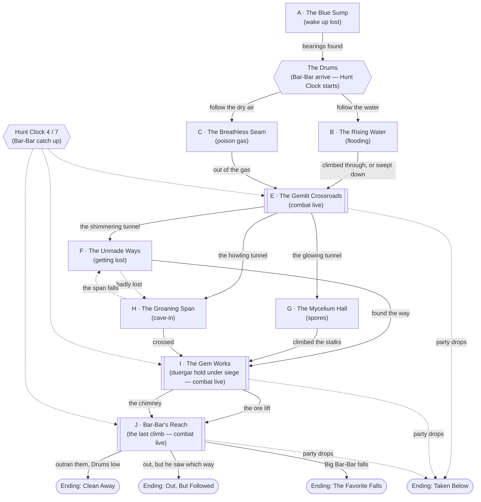

# The Underspill

## Premise

The [Blue Wave](the-blue-wave.md) doesn't drown the party. It *swallows* them. The flood tears open
a sinkhole on the [Spillway Valley](../world/places/the-spillway-valley.md) floor and pours down
into the Underdark, carrying the party with it. They wake hundreds of feet down on a black-rock
shelf beside a churning pool of very blue water. They have no map, half their gear is gone, and
they have no idea where they are. See [The Underspill](../world/places/the-underspill.md).

Three things fill the session. The first is **getting out**: finding a way up through tunnels that
were never meant for them. The second is **the Underdark itself**: the party picks which
environmental hazards to face along the way and **never faces all of them**. The third is **being
hunted**. Everyone down here is hostile. The locals are the gem-encrusted
[gemified](../world/places/fearus-dungeon.md) and the duergar who make them, and both are already
under attack. The attackers are the [Bar-Bar Clan](../world/factions/bar-bar-clan.md), an
undefeated crowd-favorite bugbear clan that [Agent](../world/npcs/agent.md) has just dropped in to
kill everything that lives here, plus the four new arrivals.

If the party gets through the hazards and outruns the Bar-Bar, they reach the surface and pick up
their quest again: finding another patch of ground Agent's signal can't reach.

## Escalation Trigger(s)

- **Hard, after Node A: The Drums.** The moment the party has its bearings and starts to move,
  bugbear war drums boom up through the rock. Then comes a duergar warhorn, cut off mid-note. Agent
  cuts in, lagging and echoing, to introduce the Bar-Bar with a recap reel. From here on, the
  **Hunt Clock** (below) is running. Combat isn't forced yet, but something down here is now
  actively looking for the party.
- **Soft, Hunt Clock thresholds.** At **4**, a Bar-Bar hunting pair catches up at the next node. At
  **7**, Big Bar-Bar is personally on their trail. Both raise the ceiling on the next node and
  don't force initiative. See the clock.
- **Hard, Node J: Bar-Bar's Reach.** Once the party commits to an exit from the Gem Works, the
  Bar-Bar war-chief catches up during the climb, however well the session has gone. The Hunt Clock
  decides **how close** he is when it starts, not **whether** he shows.
- **Soft, combat-live nodes (E, I, J).** Combat can open from a failed check, from the party
  choosing to fight, or from the locals deciding the party looks like food. Every one of those
  nodes also has a way through without a fight.

## The Hunt Clock

Track **Drums** from 0 to 8, openly. Let the players see the number climb. Hearing the drums get
closer is half the fun.

**Starts at 1** when The Drums fires.

| Raises Drums | Amount |
|---|---|
| Entering any new node (time passes) | +1 |
| A loud failure: shrieker, cave-in, explosion, a gemified Shatterburst chain | +1 to +3, as noted per node |
| Stopping for a short rest | +2 |

| Lowers Drums | Amount |
|---|---|
| *Cover the trail*: once per node, one PC spends their part of a beat on it. DC 15 Survival. | −1 |
| Leading Bar-Bar into the gemified or the duergar so they fight each other | −2 |
| Dropping the Groaning Span behind them (Node H) | −3 |
| Diverting the flood behind them (Node B) | −2 |

| Threshold | What happens |
|---|---|
| **4+** | A **Bar-Bar hunting pair** (2 Brutes) shows up at the next node: in the combat at E or I, or partway through a hazard node, reaching for whoever is last in line. |
| **7+** | **Big Bar-Bar** is personally tracking them. He joins the next combat-live node, and Node J starts with him already in reach. |
| **8** | Cap. Node J starts with Big Bar-Bar **and** 2 Brutes in reach, and the party has no head start. |

## Party

- **Tier/level:** level 5, the same four as [The Blue Wave](the-blue-wave.md): Phil, Jack, Mitch,
  and Geezus.
- **Assumed size:** 4.
- **Resources are the hidden difficulty.** The party starts this session battered, partly
  unequipped, and possibly exhausted (Node A). Nobody gets a long rest. Every short rest costs +2
  Drums. Size every fight below as a fight against a tired party, not a fresh one.

## Node Graph

The party always goes **A → (B or C) → E → (F, G or H) → I → J**. That's three environmental
hazards out of six possible routes (B, C, F, G, H, and the J climb), and the party chooses each
one. Getting lost or a collapse can shove them sideways into a route they didn't pick.





Legend: rectangle = hazard or skill node, subroutine box = combat is live here, hexagon = a hard or
clock-driven beat rather than a rolled outcome, stadium = an ending. Dotted edges happen at the DM's
discretion or when a clock hits a threshold.

**Running the hazard nodes (B, C, F, G, H).** Each one is a short run of **beats**. On each beat,
every PC picks an approach (or helps someone else's, which gives advantage) and rolls once. If at
least half the party succeeds, the beat goes the party's way. If not, it goes against them and
everyone who failed pays that node's cost. Three beats is about right per node. Cut to two if the
session is running long.

---

### Node A — The Blue Sump

**Situation:** Cold. Wet. Dark, except for a faint violet shimmer in the rock overhead (faerzress,
though nobody needs to know the word) and the pool itself, which glows a soft, ridiculous blue. The
wave water is still pouring in through a crack far overhead, a roaring white column falling into
the sump. The PCs wake one at a time on a shelf of black rock, coughing up blue water. Lay one PC
of your choice (whoever was farthest from the group when the wave hit) apart from the others, in a
side alcove, out of sight but within shouting distance.

**Agent is still here, just lagged.** Its voice reaches them three or four seconds late, echoing
strangely off the stone: *"—testants? Can you— ohhh, the delay is* terrible *down here. Okay. Okay!
Folks, they're alive! They're DOWN there! And you will not BELIEVE who else is down there—"* and
it cuts out. Play the lag as a tease, not as a dead zone. The party may hope the rock blocks Agent.
It doesn't. The Underdark is not the free zone they're looking for. Agent is just having trouble
getting a clean feed.

**Do not touch the nosebleed thread from The Blue Wave.** That stays parked for the next free zone.

**Approaches (all of these are free-form, with no beats or clock yet; the Drums haven't started):**
- *Shake it off* — DC 10 Constitution save, each PC. Failure: 1 level of exhaustion (waterlogged
  lungs, a cracked rib), cleared by the first short rest.
- *Regroup with the lost PC* — DC 5 Perception (shouting) or just walking around. Free. Let it play
  as a relieved reunion.
- *Recover gear* — each PC rolls a d6. On a 1–2, they lost something that matters (DM picks: their
  light source, a weapon, a pack, tools). DC 10 Investigation finds it washed up on the shelf. If it
  sank, getting it back takes a DC 15 Athletics dive into the sump. Failure: 1d6 bludgeoning from
  the churn, and it's gone.
- *Read where they are* — DC 15 Nature or Survival: very deep, at least a few hundred feet. Air is
  moving, so there are ways up. The violet glow is something natural to this place. DC 10
  Perception spots a dead duergar washed against the rocks, red gems studding his armor, a gem-pick
  in his belt, and Dwarvish mining marks on the two tunnel mouths.
- *Read the mining marks* — Phil (half-dwarf) reads them for free. Anyone else needs DC 10 History
  or a language. One tunnel, the wet one, reads "WATERCOURSE: UP." The other, the dry one, reads
  "SEAM 4: BAD AIR, NO FLAME."

**The Blue Stain (optional texture, recommended).** Agent's dye didn't wash out, and under
faerzress it glows. Every PC who went into the wave starts with **Blue Stain**: in darkness, they
shed a faint blue glow and have disadvantage on Stealth checks against anyone with darkvision
(everyone down here). Scrubbing it off with grit and sump-sand takes ten minutes, which costs +1
Drums once the Drums are running and nothing before. Route B re-stains anyone who goes under.

**Exit:** once the party has had its beat to recover and starts deciding which way to go, fire
**The Drums**.

---

### The Drums (hard trigger)

A deep, rhythmic **BOOM — BOOM — BOOM-BOOM** rolls up through the stone from somewhere below and
east. A duergar warhorn answers it and cuts off mid-note. Then screaming, a long way off. Then
chanting, dozens of voices: ***"BAR! BAR! BAR! BAR!"***

Agent's feed comes back, lagged and thrilled:

> *"—and they're BACK! Undefeated! Never once eliminated! The only crowd favorites in Competition
> history to VOLUNTEER — volunteer! — for every single Blood Bowl! Ladies and gentlemen, the
> BAR-BAR CLAN! And I've given them the whole neighborhood to play with — the locals, the other
> locals, and, oh, would you look at that — four brand-new contestants who washed in just in time."*

Set **Drums to 1**. The party now chooses a tunnel:
- **"Follow the water"**, the WATERCOURSE: UP tunnel → **Node B**. The wave is still pouring in,
  so the climbing watercourse is filling.
- **"Follow the dry air"**, the SEAM 4 adit → **Node C**. There's a faint draft, and the mark says
  no flame.

---

### Node B — The Rising Water

**Situation:** A narrow, steep, natural watercourse climbing alongside the inflow, slick with blue
water and still rising. Some sections are already flooded to the ceiling. Behind them, the roar of
the falling wave never stops. **Run 3 beats.** Each beat, the water is visibly higher than it was.

**Approaches:**
- *Swim the flooded section* — DC 10 Athletics. Holding breath works normally (1 + Con mod
  minutes), so nobody is drowning on one bad roll. The danger is the current.
- *Find the air pockets* — DC 10 Perception or Survival. Success: the whole party has advantage on
  this beat's Athletics. This approach is that PC's roll for the beat.
- *Run a line* — DC 10 Athletics by one lead climber (Jack is the obvious pick). Success: everyone
  else passes this beat automatically. Failure: the lead takes the beat's cost **and** the line
  doesn't hold.
- *Divert the flood behind them* — DC 15 Nature, Tinker's Tools, or a fitting spell, once per node.
  This means spotting a chokepoint and collapsing it or rerouting the water down a side fissure.
  Success: **−2 Drums**, because the tunnels behind them flood and the Bar-Bar have to go around.
  It also floods the gemified's warren below, so they arrive at Node E angry and soaked (Node E
  starts hostile, with no Stealth window). Failure: rocks shift loudly, +1 Drums.

**Cost of a failed beat:** each PC who failed takes 2d6 bludgeoning, gets re-stained (Blue Stain),
and +1 Drums from all the thrashing.

**Two failed beats: swept.** The current takes them. They're dumped, battered, out of a side outflow
straight into **Node E**, losing one item each (DM's pick) and arriving at the **bottom** of the
crossroads (worse position). Three successful beats instead puts them at E from **above**, on a
ledge with a view down, and they have surprise if combat opens.

**Complications available here:** a dead Bar-Bar brute wedged in a crack, drowned, a ridiculously
long glaive still in his fist (usable: reach weapon, heavy); Agent's lagged voice suddenly booming
out of the water itself; a pocket of trapped air that is not air (see Node C's gas, 2d6 poison).

---

### Node C — The Breathless Seam

**Situation:** A dry duergar mine adit, abandoned in a hurry. Picks dropped, ore carts tipped. The
seam broke into a gas pocket: **chokedamp**, a red-tinged gas from the gem veins. It's heavier than
air, pools low, and is **flammable**. The draft is real. This tunnel does go up, through three
galleries. **Run 3 beats, one per gallery.**

**The flame problem:** any open flame or fire spell in the seam ignites the gallery. Everyone in it
makes a DC 13 Dexterity save, taking 4d6 fire on a failure or half on a success. The roof partly
comes down and it's **+2 Drums**. Torches are the obvious trap. Darkvision, glowing Blue Stain, and
any non-flame light are fine. Let a player who reads the "NO FLAME" mark feel very smart.

**Approaches:**
- *Read the air* — DC 10 Survival or Nature. Success: they know it pools low and lead everyone
  along the upper rails. The party has advantage on this gallery's saves.
- *Hold breath and push through* — DC 13 Constitution save. Failure is the beat's cost.
- *Rig masks* — DC 10 Medicine or Survival (wet cloth and charcoal). Success: that PC and one other
  have advantage on Constitution saves for the rest of the node.
- *Open the vent shaft* — DC 15 Investigation to find the duergar ventilation shaft, then DC 15
  Athletics to wrench its hatch. Success clears the remaining galleries entirely, with no more
  saves. Cost: it opens a sound path to the deep tunnels, so +1 Drums.
- *Search the dead miners* — DC 10 Investigation, once. Finds a **duergar mine map** (Dwarvish).
  Reading it gives advantage on the first beat in Node F, **or** shows the Gem Works layout
  (advantage on the party's first Stealth check in Node I). Also finds 1d4 loose red gems (see
  Complication Bank: *Gem bombs*).

**Cost of a failed beat:** each PC who failed takes 2d6 poison and is poisoned until a short rest.
A PC who is **already poisoned** and fails again also gains 1 level of exhaustion instead.

**Exit:** a side gallery spills out into **Node E**, onto a mid-level ledge.

**Complications available here:** a caged cave-beetle (the duergar's version of a canary) still
alive and clicking. It goes quiet ten seconds before a gas pulse, if anyone thinks to carry it.
Another: a Bar-Bar scout drops into the far end of the gallery, sees the party, and lights a torch
to see better. Make a DC 10 Perception check to realize what happens next.

---

### Node E — The Gemlit Crossroads

**Combat is live.**

**Situation:** A big natural cavern where five tunnels meet. Red gems grow out of the walls in
clusters, giving the whole room a sullen red glow (the same gems as
[Fearus Dungeon](../world/places/fearus-dungeon.md)). This is a **gemified** nest: naked,
gem-studded humanoids, hostile to anyone without gems. There are five of them, crouched over the
bodies of a duergar patrol and a dead Bar-Bar brute they took down together. They are hurting and
they are furious. They are locals, and something is invading their home. The party looks like more
of the same.

Three tunnels lead on. The party picks one:
- **"The shimmering tunnel"** → **Node F.** No draft. The air shimmers violet with faerzress. The
  gemified avoid it; there are no tracks at all. On paper it's the shortest way to the Gem Works.
- **"The glowing tunnel"** → **Node G.** Warm, humid, and lit by bioluminescent fungus. It smells
  of rot, and there's a strong updraft. It rises fast.
- **"The howling tunnel"** → **Node H.** Wind howls through it. Stone groans and cracks
  periodically. There are old duergar road markers. This is the fastest route (**+0 Drums** to
  enter instead of +1) and the riskiest.

**Approaches:**
- *Slip past* — DC 10 Stealth, group check (disadvantage for anyone with Blue Stain; no Stealth
  window if Node B's flood diversion soaked this nest). Success: they take any tunnel unseen.
- *Read the tunnels* — DC 10 Perception or Survival gives the descriptions above. Without it, the
  party just sees three dark holes. Phil reads the duergar road markers for free.
- *Interrogate the dying duergar* — one of the patrol is still breathing. DC 10 Intimidation (he is
  hostile and spits at them; Persuasion won't work). He snarls out that the Gem Works, up the
  hill, has an ore lift to the top, then tries to stab whoever is closest. This tells the party the
  Gem Works is the way out.
- *Feed the gemified to the Bar-Bar* — if a Bar-Bar hunting pair is here or close (Drums 4+), DC 15
  Deception or Stealth. Make noise from a side tunnel and steer the two groups into each other.
  Success: **−2 Drums**, and the party slips out while the locals and the clan tear into each
  other.
- *Talk to the gemified* — DC 20 Persuasion. Even a success only buys one round of confused
  hesitation. Something in them still remembers being spoken to kindly. They are not talkable.
- *Fight* — see Combat Notes. The gem clusters on the walls are a hazard **and** a weapon.

**Cluster chain:** when a gemified's **Shatterburst** goes off within 5 feet of a wall cluster, the
cluster blows too. Every creature within 10 feet of it makes a DC 12 Dexterity save, taking 3d6
piercing on a failure or half on a success. **+1 Drums** per cluster. This is the same chain
reaction the party set off at Fearus. If anyone remembers, they know exactly how to weaponize it on
purpose (DC 10 to aim a throw or shot at a cluster).

**Complications available here:** a Bar-Bar hunting pair arrives in round 2 (if Drums 4+) or round
4 (otherwise, if the fight is loud), reaching over the gemified to hit the party. The Bar-Bar
don't care who they kill first.

---

### Node F — The Unmade Ways

**Situation:** Faerzress-soaked tunnels where space doesn't quite hold together. Passages loop back
on themselves. The same three stalagmites turn up for the fourth time. A compass spins lazily. The
draft comes from one direction, then another. Agent's lagged voice drifts in from the **wrong side**.
**Teleportation and divination misfire here**: a teleport lands 1d6 × 10 feet in a random
direction, and divinations return static.

**Bearings track:** the party needs **3 Bearings before 3 Lost**. Each beat, one navigator rolls
and others can help (advantage) or roll their own approach.

**Approaches:**
- *Navigate by instinct* — DC 15 Survival. Success: +1 Bearing.
- *Mark the walls* — DC 10 Investigation (chalk, scratched arrows, a trail of something). Success:
  +1 Bearing. A **second** success on this approach catches a loop: +1 Bearing more.
- *Follow the draft* — DC 10 Perception. Success: +1 Bearing. **But** if the roll fails by 5 or
  more, they followed a false draft that the faerzress made up: +1 Lost instead of just a failure.
- *Read the faerzress currents* — DC 15 Arcana. Success: **+2 Bearings** (the shimmer flows
  "downhill" toward bigger caves).
- *The duergar mine map* (from Node C) — advantage on the first beat.

**Each failed beat:** +1 Lost, +1 Drums, and roll a d4 for what the tunnels do:
1. **Split.** One PC (random) turns a corner and is alone. DC 10 Perception or a loud shout
   reunites them next beat. Until then they roll separately.
2. **Echoes.** Their own voices, a few seconds behind, coming from ahead of them. Fresh footprints
   in the dust that match their boots. Harmless. Play it for dread.
3. **Stragglers.** Two gemified wander out of a side passage. Short fight or a DC 10 Stealth check
   to wait them out.
4. **Agent's wrong turn.** Agent's voice, clear for once, cheerfully calling "This way!" from a
   side passage. Following it costs a beat and gains nothing. Agent swears afterwards it was
   trying to help, and maybe it was.

**3 Bearings:** they come out into a cramped undercut **beneath the Gem Works**. That's a back door:
advantage on the party's first Stealth check in Node I.

**3 Lost: badly lost.** +2 Drums. They stumble out somewhere they didn't choose: at the near end of
**Node H** (they have to cross the Span after all) or, if they already came *from* H's collapse, at
the base of **Node G**'s fungus stalks. The tunnels decide.

---

### Node G — The Mycelium Hall

**Situation:** A vast, warm cavern full of giant fungus, stalks thick as tree trunks rising into
the dark, caps glowing blue and green. The updraft is strong. Climbing the stalks leads up toward
the Gem Works' lower galleries. It's beautiful and it's dangerous. **Shriekers** stand among the
caps, and anything that walks past them sets them off. Spore puffs drift through the air. **Violet
fungi** lurk in the clusters. **Run 3 beats.**

**Spore hallucination (flavor for failed saves):** a PC who breathes in spores hears a studio
audience. Laughter, applause, an "ooooh" when someone stumbles. It may not be a hallucination.
Agent never confirms either way.

**Approaches:**
- *Thread between the shriekers* — DC 10 Stealth, group (Blue Stain gives disadvantage). Failure:
  they shriek. **+2 Drums** for the beat, instead of the usual cost.
- *Know your fungus* — DC 10 Nature or Survival. Success: the party avoids the violet fungi and has
  advantage on spore saves for the rest of the node.
- *Burn a path* — no check. Fire works, and it's fast: it clears a beat automatically. But burning
  fungus throws off a spore cloud (DC 13 Constitution save for everyone, poisoned on a failure) and
  a pillar of light and smoke, so **+1 Drums**.
- *Climb the stalks* — DC 10 Athletics. This is the main way up. Success moves the party up the
  hall. On a failure, the PC slides 15 feet and takes 1d6 bludgeoning, and that's the beat's cost.
- *Harvest* — DC 15 Nature or Medicine, once per PC. Success: 1d2 **gloomcaps**. Eating one heals
  2d4 + 2. Mitch, Geezus, or anyone else's player will want these. Let them have them.

**Cost of a failed beat:** each PC who failed makes a DC 13 Constitution save against a spore puff
or is poisoned (and hears the audience) until the end of the next beat. A party that fails the
beat also drifts into a violet fungus cluster (2 violet fungi). That's a short, ugly fight or a DC
10 Athletics check to tear free.

**Exit:** the top of the stalks reaches a crack into the Gem Works' lower galleries → **Node I**.

**Complications available here:** a gemified, half-overgrown with mycelium, standing perfectly
still in the caps. Nobody knows how long it's been there. Agent says the sponsors love "this kind
of nature content."

---

### Node H — The Groaning Span

**Situation:** The old duergar road crosses a deep chasm on a single stone bridge, 120 feet long,
no rails, cracked down the middle. Wind howls up out of the dark. The rock **groans**: aftershocks,
the merged world still settling. This is the fastest way (+0 Drums to enter) and the scariest.
**Run 3 beats, one per third of the bridge.**

**Tremors:** at the start of each beat, roll a d6. On a 1–2, a tremor hits. Everyone on the Span
makes a DC 13 Dexterity save or falls prone and slides toward the edge. A PC who fails by 5 or more
goes **over** unless they're roped in (they catch the lip: DC 10 Athletics to climb back on their
next turn).

**Approaches:**
- *Cross carefully* — DC 10 Acrobatics.
- *Rope up* — DC 10 Athletics or Survival, once at the start. Success: the party is roped together.
  Anyone who goes over is caught. The PC on the other end of the rope takes 1d6 bludgeoning instead
  and nobody falls.
- *Find the strong line* — DC 15 Investigation, Tinker's Tools, or stonecunning (Phil). Success:
  advantage on this beat and the next.
- *Drop it behind them* — DC 15 Athletics, Tinker's Tools, a gem bomb, or a strong spell, attempted
  once the whole party is across (or nearly). Success: the Span falls and **−3 Drums**. The Bar-Bar
  have to go all the way around. Failure while anyone is still on it: the Span falls **with them
  on it**. Everyone on it makes a DC 13 Dexterity save. On a failure, they fall 30 feet onto a
  ledge below (3d6 bludgeoning) and wash out into **Node F**'s tunnels. On a success, they cling to
  the far edge.

**Cost of a failed beat:** each PC who failed slips, falls prone, and stops moving. Their next roll
on the Span is at disadvantage. +1 Drums once per failed beat, as the old stone cracks loudly.

**Drums 4+ while crossing:** the Bar-Bar hunting pair arrives at the **far** end, ahead of the
party, having come by another way. With 15-foot reach they can hit anyone stepping off the bridge,
and they throw javelins at anyone still on it. Shoving a Bar-Bar into the chasm is a great use of a
turn: contested Athletics, and they have **Won't Stay Down**, but falling doesn't care about that.

**Exit:** the road climbs to the Gem Works' main gate → **Node I**.

---

### Node I — The Gem Works

**Combat is live.**

**Situation:** The duergar hold. A fortified mine cut into a huge cavern wall: terraces, forges,
gem-crushing mills, and rows of pens. In the pens are **captives being made into gemified**, force-
fed red gems the same way the party saw at [Fearus Dungeon](../world/places/fearus-dungeon.md).
Some are half-turned, gems pushing through their skin, still able to beg. And the hold is **under
siege**. Bar-Bar warriors are scaling the terraces, battering the gate, and chanting. The duergar
hold the upper works with crossbows and enlarged hammerers. Both sides are winning in some places
and losing in others. Everyone is hostile to the party.

Two ways up and out, both at the back of the hold:
- **The Ore Lift** — an iron cage on a chain up a 300-foot shaft to the surface, driven by a
  counterweight winch. It's fast, loud, and guarded by duergar at the winch house.
- **The Chimney** — a natural vent behind the slag heaps that climbs to a pinprick of daylight.
  It's quiet and hidden but slow, and it's a real climb.

**Approaches:**
- *Slip through the siege* — DC 15 Stealth, group. Advantage from Node F's back door or Node C's
  map, disadvantage from Blue Stain. Success: they reach their chosen exit without a fight.
- *Pass as one side or the other* — DC 15 Deception. That means wearing Bar-Bar trophies (bones,
  the long glaive from Node B) or posing as gem-studded captives (crushed gem dust and grime). It
  buys a few rounds before someone looks twice.
- *Open the pens* — DC 10 Thieves' Tools or Athletics. The captives and the half-turned flood out,
  hostile to anyone ungemified, the party included. The hold collapses into chaos. The party has
  advantage on Stealth for the rest of the node, and **−2 Drums**. This is a heavy choice. Some of
  those captives were people last week. Let the table feel it either way.
- *Blow the gem stockpile* — DC 10 to land any fire, force, or gem-bomb on the crushing-floor
  stockpile. 6d6 piercing and fire in a 20-foot radius around it. It shatters both sides' lines
  and clears the way. Cost: **+3 Drums**. Big Bar-Bar comes straight for that noise.
- *Seize the winch house* — fight or bluff through 2–3 duergar to work the Ore Lift. DC 10 Tinker's
  Tools or Athletics to release the counterweight. DC 15 Thieves' Tools first if the duergar locked
  the lever (they did, if anyone ran to warn them).
- *Fight* — see Combat Notes. The siege is a three-sided brawl. The party only has to beat whoever
  is between them and the exit.

**Exit:** the party commits to the Ore Lift or the Chimney → **Node J**.

**Complications available here:** a duergar overseer screaming for the party to be taken **alive**
(they'd make good gemified); a Bar-Bar warrior hurled off a terrace by an enlarged duergar,
landing at the party's feet and very much still alive (Won't Stay Down); the pens' half-turned
captives shouting in English, which is unsettling, because some are Earth people.

---

### Node J — Bar-Bar's Reach

**Combat is live. Hard trigger: Big Bar-Bar catches up during the climb, every time.**

**Situation:** The last climb. Partway up, the drums stop. In the silence, ***"BAR! BAR!"*** from
directly below, and a shape far too big for the shaft comes up after them, faster than they're
climbing, its arms absurdly long. **Big Bar-Bar**, the clan's war-chief, reaches 20 feet. He has
never been eliminated. Agent's feed is suddenly crystal clear, because Agent would not miss this.

**Head start by Drums:**

| Drums | Big Bar-Bar starts... |
|---|---|
| 0–3 | 3 rounds behind. He reaches the bottom of the shaft or chimney as they're nearing the top. |
| 4–6 | 1 round behind. |
| 7 | In reach at the start. |
| 8 | In reach at the start, with 2 Brutes climbing behind him. |

**Route: the Ore Lift.** The cage rises 75 feet per round, so it takes **4 rounds** to clear the
shaft. Big Bar-Bar climbs the chain hand over hand (speed 40, he doesn't need to roll) and swings
up through the cage bars, reaching in at anyone inside.
- *Jam the gears below* — DC 15 Tinker's Tools or Athletics, before the cage leaves (only possible
  with 1+ round of head start). Brutes can't follow, and Big Bar-Bar has to climb bare rock (half
  speed).
- *Shake him off the chain* — contested Athletics, or 10+ damage from one hit while he's climbing.
  He drops 30 feet. He'll take the fall damage and keep coming (Won't Stay Down), but it costs him
  a round.
- *Cut the cage loose at the top* — once the party is off, DC 10 to drop the cage back down the
  shaft. If he's on it, he rides it 300 feet down. He survives, of course. It takes him a very long
  time to come back up.

**Route: the Chimney.** It's quiet, and if the Drums are low he may not even know which way they
went (with Drums 0–3, make it 4 rounds of head start instead of 3). It takes **3 climbing stages**,
DC 10 Athletics each (DC 5 with a rope run from the top). On a failed stage, the PC slides back
and loses a round. Big Bar-Bar climbs a stage per round without rolling, and his reach hits anyone
one stage above him.
- *Drop rocks* — DC 10 Athletics to dislodge a slab. He makes a DC 13 Dexterity save or gets
  knocked back one stage.
- *Wedge the chimney* — DC 15 Athletics or Tinker's Tools at a narrow point. He's Large, so he can
  get through, but he loses 2 rounds squeezing.

**Either route:**
- *Call him out* — DC 15 Intimidation or Persuasion, or DC 10 if Mitch plays to the crowd and Agent
  takes the bait. **Single combat**, one PC versus Big Bar-Bar, for passage. The Bar-Bar are show
  veterans, and the crowd always wants the duel. If the champion survives 3 rounds or takes him
  below half HP, he roars, laughs, and lets them go. Bar-Bar respects that. He'll hunt them again
  next time with real affection. This is the clan's **way to settle it without a war** (see
  [Crowd Favorites](../world/lore/crowd-favorites.md)'s design rule).
- *Just fight* — he's built to be very hard to kill (see Combat Notes). Killing him is possible and
  enormous.
- *Reach the surface* — the party escapes when everyone is out and they've put 60 feet or a
  barrier between themselves and the hole. He won't chase far into daylight. Bar-Bar hunts in the
  dark, and he's a showman. He'd rather promise a rematch on camera.

---

## Endings

- **Ending: Clean Away.** The party reaches the surface with Big Bar-Bar shaken off, wedged in,
  ridden down a shaft, or never sure which way they went. Daylight, wind, and somewhere unmapped
  (further west than the Spillway Valley, if you want to keep the "go west" thread). Agent, the
  lag gone: *"Contestants ONE, Underdark ZERO! And folks, the Bar-Bar are* not *going to forget this."*
  The quest to find another Agent-free zone picks up from here.
- **Ending: Out, But Followed.** They reach the surface but leave Big Bar-Bar knowing exactly where
  they came up, or they won the duel. The Bar-Bar Clan is now a **recurring hunter on the
  surface**: drums at night at the edge of camp, a long glaive left planted in the ground as a
  calling card. They can return in any later session that needs a pursuer.
- **Ending: The Favorite Falls.** Big Bar-Bar dies, which means beating Won't Stay Down **and**
  his Legendary Resistance. The crowd goes absolutely feral. Per
  [Crowd Favorites](../world/lore/crowd-favorites.md), a favorite knocked out by an underdog is
  *better* than a win, and Agent is beside itself: *"Never — NEVER — in Competition HISTORY—"*. The
  clan below falls silent, then starts a new chant: the party's names. Whether that's a mourning
  song or a blood-oath is for a later session. The clan always volunteers again, and a new
  Big Bar-Bar will be chosen.
- **Ending: Taken Below.** The party drops at Node E, I, or J. The Bar-Bar leave them for dead and
  move on to bigger prey. The duergar find them breathing and drag them to the Gem Works pens.
  Next session is a prison break with gems on the menu, a ticking transformation clock, and Agent
  absolutely loving it. Don't play this as a TPK. Play it as a worse place to start from.

## Complication Bank

- **Gem bombs.** Loose red gems (from Node C's miners, Node E's walls, or the Gem Works) can be
  thrown hard to set off the chain reaction from Fearus: DC 10 Dexterity to throw well, then
  5-foot radius, DC 12 Dexterity save, 2d6 piercing. Loud, so +1 Drums each. Let the party discover
  this as a tool.
- **The light runs out.** Any torch, lantern oil, or battery that survived the wave is running
  down. Calling for it at a tense moment is free drama. Darkvision PCs carry the others.
- **Aftershock.** The world settles again. Dust falls, a tunnel behind them pinches shut, and a new
  crack opens ahead. Use it to cut off a retreat, open a shortcut, or separate one PC for a beat.
- **Sponsor drop.** Agent, feeling generous or bored, drops a branded supply crate. It holds exactly
  one useful thing (a 50-foot rope, a flare, a single healing potion) and a Bar-Bar-sized second
  crate labelled "FOR THE OTHER TEAM." Agent pretends this was a shipping error.
- **A lone Fulgurite.** A [Fulgurite](../world/races/fulgurites.md) from the Underdark's other Earth
  fragment stumbles into the scene, terrified, glassy skin crackling. It is hostile like everyone
  else and could Overcharge at the worst moment. It's also a hint that this isn't the only Earth
  fragment down here.
- **Bar-Bar trophy line.** A tunnel strung with duergar helmets and gemified gem-clusters on long
  cords, swaying. A warning, a territory marker, and a great place to steal a disguise for Node I.
- **Agent's lag works both ways.** Agent's narration reaches the *Bar-Bar* too, through
  whatever earpieces crowd favorites get. A clever party can make Agent announce something false
  ("—and they've gone into the FUNGUS—"). DC 15 Deception aimed at Agent itself, played as Agent
  happily taking the bait because it's funnier.
- **Viewer poll.** Agent runs a live poll on which tunnel the party should take, then announces the
  result to everyone, Bar-Bar included. Ignoring the crowd's pick is −1 Drums, and Agent pouts.
  Taking it gives the party one free reroll in that node (the audience is invested).

## Combat Notes

**Built for 4 level-5 PCs who are tired.** No long rest all session, every short rest costs +2
Drums, and they may start with exhaustion from Node A. Size every fight below **lighter** than you
would for a fresh party, and remember most of these fights are about **getting past**, not
clearing the room.

### Gemified Thrall (CR 1, 200 XP)

The first full block for the gemified from [Fearus Dungeon](../world/places/fearus-dungeon.md).

*Medium humanoid, chaotic neutral.* **AC** 13 (gem plating) · **HP** 33 (6d8+6) · **Speed** 30 ft.
STR 14 (+2) DEX 13 (+1) CON 13 (+1) INT 6 (−2) WIS 10 (+0) CHA 6 (−2).
**Damage Resistances** piercing. **Senses** darkvision 60 ft., passive Perception 10.
**Languages** understands whatever it spoke before; speaks only in fragments.
- **Gemlight.** Sheds dim red light in a 10-foot radius. It can't hide in darkness.
- **Hates the Unstudded.** Has advantage on attack rolls against a creature with no gems embedded
  in it if another gemified is within 5 feet of that creature.
- **Shatterburst.** When reduced to 0 hit points, it bursts. Each creature within 5 feet makes a
  DC 12 Dexterity save, taking 7 (2d6) piercing on a failure or half on a success. A wall cluster
  within 5 feet goes off too (see Node E).
- **Multiattack.** Two Gem-Studded Fist attacks.
- **Gem-Studded Fist.** *Melee Attack:* +4 to hit, reach 5 ft. *Hit:* 5 (1d6 + 2) bludgeoning plus
  2 (1d4) piercing.

### Duergar

Use the standard **Duergar** (MM, CR 1) for the rank and file: enlarge, invisibility, war picks and
javelins. For the Gem Works' officers, use a **Duergar Hammerer** or **Duergar Stone Guard**
(*Mordenkainen's Tome of Foes / Monsters of the Multiverse*, CR 2). Give officers a few loose red
gems to throw as gem bombs. Whether these are the [Ashvein Company](../world/factions/ashvein-company.md),
the Fearus operation, or both is still the open question in Fearus Dungeon's DM notes. This file
deliberately doesn't settle it. Settle it there, once, if the table asks.

### Bar-Bar Brute (CR 2, 450 XP)

*Medium humanoid (goblinoid, bugbear), chaotic neutral.* **AC** 14 (hide armor) · **HP** 52 (8d8+16)
· **Speed** 30 ft.
STR 17 (+3) DEX 14 (+2) CON 15 (+2) INT 8 (−1) WIS 11 (+0) CHA 10 (+0).
**Skills** Athletics +5, Stealth +6, Survival +2. **Senses** darkvision 60 ft., passive Perception 10.
**Languages** Common, Goblin.
- **Long-Limbed.** Its melee reach is 15 feet with the glaive (5 feet longer than normal), and 10
  feet unarmed.
- **Won't Stay Down (1/Day).** When reduced to 0 hit points by anything other than a critical hit,
  it drops to 1 hit point instead.
- **Surprise Attack.** If it hits a creature that is surprised or hasn't acted yet this combat,
  the target takes an extra 7 (2d6) damage.
- **Multiattack.** Two Long Glaive attacks, or two Javelin attacks.
- **Long Glaive.** *Melee Attack:* +5 to hit, reach 15 ft. *Hit:* 8 (1d10 + 3) slashing.
- **Javelin.** *Ranged Attack:* +5 to hit, range 30/120 ft. *Hit:* 6 (1d6 + 3) piercing.

### Big Bar-Bar, War-Chief (CR 6, 2,300 XP)

*Large humanoid (goblinoid, bugbear), chaotic neutral.* **AC** 16 (patchwork plate of
previous-cohort trophies) · **HP** 136 (16d10+48) · **Speed** 40 ft., climb 30 ft.
STR 20 (+5) DEX 14 (+2) CON 17 (+3) INT 9 (−1) WIS 12 (+1) CHA 14 (+2).
**Saving Throws** Str +8, Con +6. **Skills** Athletics +8, Intimidation +5, Perception +4,
Stealth +5. **Senses** darkvision 60 ft., passive Perception 14. **Languages** Common, Goblin.
- **The Long Reach.** His melee reach is **20 feet**. He carries the clan's oldest polearm, an
  absurd length of black-iron haft and hook that once belonged to the original Bar-Bar.
- **Won't Stay Down (2/Day).** When reduced to 0 hit points by anything other than a critical hit
  or radiant damage, he drops to 1 hit point instead.
- **Legendary Resistance (1/Day).** If he fails a saving throw, he can choose to succeed instead.
- **Multiattack.** Two Long Reach attacks.
- **Long Reach.** *Melee Attack:* +8 to hit, reach 20 ft. *Hit:* 16 (2d10 + 5) slashing.
- **Sweep (Recharge 5–6).** He swings the Long Reach in a full circle. Each creature of his choice
  within 20 feet makes a DC 15 Dexterity save. On a failure, it takes 22 (4d10) slashing and is
  knocked prone. On a success, half damage and not prone.
- **BAR! BAR! (Bonus Action, 1/Day).** He roars the clan's name. Each Bar-Bar within 60 feet that
  can hear him gains 10 temporary hit points.
- **Can't Outrun Me (Reaction).** When a creature within 20 feet of him moves, he makes one Long
  Reach attack against it. On a hit, the target's speed becomes 0 until the end of its turn.
  *This is the escape-killer.* It's what makes Node J a climb under fire rather than a race. If the
  table is struggling, have him use it on the **last** climber, not the first.

**Toughness check:** three Won't Stay Downs between his own two and a Brute's one, plus Legendary
Resistance, plus 136 HP. That's the "incredibly hard to kill" brief on purpose. He is **not**
meant to be beaten by a tired level-5 party in a stand-up fight. He's meant to be escaped,
out-thought, or dueled. Killing him should take a crit or radiant damage at the right moment, a
fall, a cage drop, or a very good plan. That's what makes **The Favorite Falls** a legend if it
happens.

### Encounter composition

- **Node E:** 5 Gemified Thralls (1,000 XP), with the wall clusters as the real damage. Add a
  Bar-Bar hunting pair at Drums 4+ (+900 XP). The pair fights the gemified as readily as the party,
  so the effective weight on the party is well under the raw sum.
- **Node I:** whatever stands between the party and their exit. Typically 2–3 Duergar plus a
  Hammerer at the winch house (about 850–1,050 XP), **or** 2 Brutes on the terraces (900 XP). Big
  Bar-Bar joins at Drums 7+ (**do not** also run him at full strength in Node J if he took real
  damage here; carry his HP forward).
- **Node J:** Big Bar-Bar alone (2,300 XP) at Drums 6 or below. Add 2 Brutes at Drums 8 (3,200 XP,
  above High for this party). That's survivable only because the goal is to **leave**, not to win.
  If he's chewing through the party, have him pause to soak up the crowd's cheering for a round.
  He's a crowd favorite, and he plays to the cameras like one.

**What ends a fight without a kill:**
- **Gemified** don't retreat. But they're drawn to anything with gems in it, so throwing a gem
  cluster past them makes most of them chase it.
- **Duergar** retreat behind their walls when the hold's fate is in doubt. They value the works
  more than a fight with four strangers.
- **Bar-Bar** never retreat, but they get **bored**. A target that's out of reach, out of sight,
  or out of the dark loses their interest in favor of the next thing to kill. A Bar-Bar can't be
  talked out of a fight, but it can always be **challenged into a better one** (see Node J's
  single combat).

---

[← Back to encounters index](README.md)
